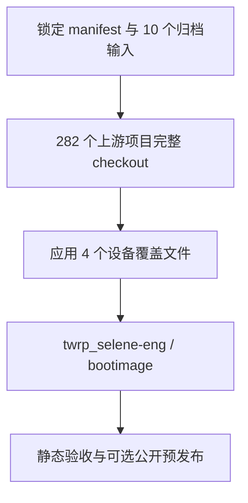

# TWRP Selene Builder

使用 GitHub Actions 和 Ubuntu Docker 容器，为 Xiaomi selene 构建 TWRP 12.1 `bootimage`。目标固件保持 China MIUI `V14.0.4.0.TKUCNXM`。

本项目是新的干净构建入口。原始实验与证据仍由私有仓库 [twrp_selene](https://github.com/Grinch27/twrp_selene) 保存。**当前尚无本项目完整编译成功或设备验收的证明。** 检查结果见 [AUDIT.md](AUDIT.md)。

## 构建方式



| 设置 | 固定值 |
| --- | --- |
| 工作流 | `.github/workflows/twrp_allinone.yml`，一个文件、两个 job |
| Runner | 共享 `resolve-runner-image@main` 动态解析 Ubuntu x64 |
| 编译容器 | `ubuntu:22.04`，与 Android 12.1 的历史主机工具依赖匹配；宿主 Runner 独立更新 |
| 源码 | `source.lock.json` 固定私有归档提交、每个输入的 Git blob 和 282 项上游 SHA |
| 产品 / 目标 | `twrp_selene-eng` / `mka bootimage -j4` |
| 资源界限 | 同步 140 分钟、编译 160 分钟、job 350 分钟；四任务、容器 14 GiB 内存 |
| 磁盘检查 | 清理后至少 50 GiB；编译前至少 18 GiB；不足立即失败 |
| 自动触发 | push / PR 运行静态检查和公开最小 repo 初始化测试；完整编译只接受 main 上的 workflow_dispatch |
| 唯一手动输入 | `publish=false`；设为 true 明确允许公开镜像、静态报告和校验和 |

源码预编译 JDK、Clang 等从锁定上游重新同步；不克隆整个 7.44 GiB Git 归档，不回放旧 `out`、Soong 测试禁用、稀疏片段或 `ALLOW_MISSING_DEPENDENCIES`。归档内 18 个 Release 大文件不作为这条干净路线的下载入口。

## 首次运行

1. 在 `Grinch27/twrp_builder` 的 **Settings → Secrets and variables → Actions** 添加 `TWRP_SOURCE_TOKEN`。使用仅选择 `Grinch27/twrp_selene`、权限仅 **Contents: read** 的 fine-grained token。不要把令牌写入源码、工作流输入或聊天。
2. 明确授权 GitHub 托管 runner 处理这十个私有输入后，再配置该 secret 并手动启动。普通 `GITHUB_TOKEN` 只属于 builder 仓库，不能用它读取另一个私有仓库。
3. 打开 **Actions → TWRP Selene (All in One Docker) → Run workflow**，选 `main`。首次建议保持 `publish=false`。
4. 完整任务会清理该次临时 GitHub runner 的预装 Android SDK、hostedtoolcache、dotnet、PowerShell 四个目录，以获得空间；不会在本地或 self-hosted runner 上运行该清理脚本。若空间门槛仍不满足，任务停止，不自动购买或选择付费 runner。
5. `publish=false` 时，镜像和完整日志仅在临时 runner 存活期间保留，job 结束后不可下载。需要公开构建产物时，手动运行并明确勾选 `publish`；成功后生成 Actions Artifact 和标记为实验性的 GitHub prerelease。

**隐私范围：** token 仅在宿主机下载步骤存在，不传入编译容器。只下载 manifest、四个已审查设备覆盖文件和五个 stock 输入，合计 11,178,084 bytes。私有源码、manifest 原文、fstab 原文、编译日志和历史证据不进入公开仓库或 Artifact。公开镜像会包含所用配置/固件，因此也必须通过 `publish` 明确批准。

失败时公开日志仅报告阶段与退出码，不自动上传编译器输出。需要保留完整私有诊断时，应先设计私有 runner/私有存储出口；不能通过直接 `cat` 或上传整个工作区绕过边界。本项目没有创建凭据、付费资源、定时任务或手机操作入口。

## 验收和限制

成功必须同时具备真实编译 exit 0、独立输出目录内的新 `boot.img`、非空且不超过 67,108,864 bytes、boot header v2 / page 2048、约定加载地址和 2023-12 patch 月份、原厂 kernel/DTB 字节匹配、gzip/newc ramdisk 中的 TWRP ELF、两份 stock-v14 fstab 和 Novatek 固件，以及 AVB 测试密钥签名验证。

这些检查不能证明启动、触摸、FBE 解密、备份恢复、动态分区或 snapshot 操作可用。报告将这些功能保留为 `NOT_TESTED`，刷写安全为 `NOT_ESTABLISHED`。本项目不执行 ADB、Fastboot、刷写或格式化。

设备覆盖层保留原有四个 `BUILD_BROKEN_*` 标志，并不新增其他绕过项。这些继承设置、旧 vendor patch 和设备能力差距在 [AUDIT.md](AUDIT.md) 中列明。若干净同步后仍缺依赖，只保留第一个失败，不自动循环补库或禁用测试。

```bash
python3 -m unittest discover -s tests -v
for script in scripts/*.sh; do bash -n "$script"; done
```

若持有原始 manifest 的本地副本，可额外静态检查：

```bash
python3 scripts/source_inputs.py manifest /absolute/path/to/default.xml
```

锁定的是源码和下载输入。Ubuntu 容器 tag、APT 包和共享 Runner Action 仍随上游更新，因此不承诺二进制逐字节重现。任何锁定更新都需重新核对来源、设备覆盖差异和真实构建结果。

## 技术依据

- [TWRP minimal manifest / twrp-12.1](https://github.com/minimal-manifest-twrp/platform_manifest_twrp_aosp/tree/twrp-12.1)：boot ramdisk 使用 `bootimage`。
- [hasan6034 selene device tree](https://github.com/hasan6034/recovery_device_xiaomi_selene/tree/c77512445ab5be5908ddb3ca9c659e6b149c78de)：设备上游，不代表 China V14 已验收。
- [azwhikaru/Action-TWRP-Builder](https://github.com/azwhikaru/Action-TWRP-Builder)：通用 Actions 构建结构参考。
- [momo54181 成功运行](https://github.com/momo54181/Action-TWRP-Builder/actions/runs/21091917719)及[对应 Release](https://github.com/momo54181/Action-TWRP-Builder/releases/tag/21091917719)：核对到非空 recovery.img，设备为 GIONEE_G1605A，并非 selene。
- [GitHub workflow syntax](https://docs.github.com/zh/actions/reference/workflows-and-actions/workflow-syntax)、[YAML anchors](https://docs.github.com/en/actions/reference/workflows-and-actions/reusing-workflow-configurations)、[GITHUB_TOKEN 范围](https://docs.github.com/en/actions/concepts/security/github_token)、[Runner 规格](https://docs.github.com/en/actions/reference/runners/github-hosted-runners)。
