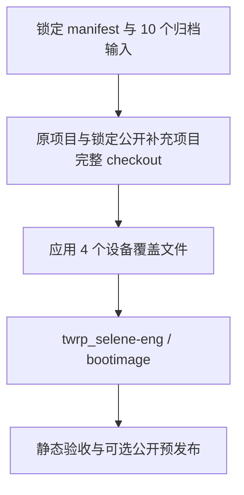

# TWRP Selene Builder

当前集中使用 GitHub Actions 的 Ubuntu 原生路线，为 Xiaomi selene 构建 TWRP 12.1 `bootimage`。目标固件保持 China MIUI `V14.0.4.0.TKUCNXM`。

本项目是新的干净构建入口。原始实验与证据仍由私有仓库 [twrp_selene](https://github.com/Grinch27/twrp_selene) 保存。**当前尚无本项目完整编译成功或设备验收的证明。** 检查结果见 [AUDIT.md](AUDIT.md)。

## 构建方式



| 设置 | 固定值 |
| --- | --- |
| 原生工作流 | `.github/workflows/twrp_native.yml`，一个文件、两个 job，不调用 Docker 或可复用 workflow |
| 暂缓的 Docker 工作流 | `.github/workflows/twrp_allinone.yml`，保留代码和手动入口，暂停 push/PR 自动运行 |
| Runner | 共享 `resolve-runner-image@main` 动态解析 Ubuntu x64 |
| 编译环境 | 原生 Ubuntu Runner，使用锁定源码中的 JDK / Clang；旧主机 ABI 通过官方归档二进制包安装 |
| 源码 | `source.lock.json` 固定私有归档提交、每个输入的 Git blob、282 项原始 SHA 和 303 项公开补充项目 SHA，共 585 项 |
| 公开测试资源 | 同版本 AOSP Recovery 的 25 张测试图片和 NOTICE；单独锁定，恢复 `res-testdata` 文件组，十项私有输入不变 |
| 产品 / 目标 | `twrp_selene-eng` / `mka bootimage -j2` |
| 资源界限 | 同步 140 分钟、编译 160 分钟、job 350 分钟；编译并行度 2。原生路线使用 Runner 可用内存并新增 12 GiB Swap，Docker 路线另限 14 GiB |
| 磁盘检查 | 清理后至少 62 GiB，其中新增 Swap 占 12 GiB；同步前保留至少 50 GiB，编译前至少 18 GiB；不足立即失败 |
| 自动触发 | 仅原生入口通过 push / PR 运行静态检查和公开同步测试；完整编译接受 main 的 workflow_dispatch。本次持续修复期间，原生路线另接受精确 `[selene-native-build-20261022] ` 标记；成功交付后恢复仅手动构建。Docker 入口仅保留 workflow_dispatch |
| 唯一手动输入 | `publish=false`；设为 true 明确允许公开镜像、静态报告和校验和 |

源码预编译 JDK、Clang 等从锁定上游重新同步；不克隆整个 7.44 GiB Git 归档，不回放旧 `out`、Soong 测试禁用、稀疏片段或 `ALLOW_MISSING_DEPENDENCIES`。归档内 18 个 Release 大文件不作为这条干净路线的下载入口。

原归档 manifest 原样保留并校验。构建前另生成仅供当前 runner 使用的有效 manifest，添加同一 `android-12.1.0_r4` 标签的完整公开 `platform/cts` 和 `platform/platform_testing` 项目，分别提供 `cts_defaults` 及其直接依赖 `platform-test-annotations`。不更新原来 282 个项目的 SHA，不新增私有下载文件。[运行 39728081394](https://github.com/Grinch27/twrp_builder/actions/runs/39728081394) 已通过 284 项同步和 checkout 校验；编译随后因缺少 `tradefed`、`compatibility-tradefed` 停止，依赖闭包仍未完成。

后续补齐同版本 `tools/tradefederation/prebuilts@2a5fd21caf0d161ef6fc2efec1fadf2f31986039`，其原始 Java import/filegroup/JAR 提供两个缺失模块。285 项运行同步和校验通过后，Soong 报告下一组 DEQP、Python 和 VNDK 缺项；已按公开提供方及其直接声明的依赖补齐，实际状态以 [AUDIT.md](AUDIT.md) 的运行证据为准。2026-10-22 用户明确要求持续修正、构建直至得到成品，因此每次失败均保留真实失败状态，再审查和修正后继续尝试，不再将旧的一轮停止约定作为暂停理由。

298 项运行完成完整同步和预检后，Soong 继续报告 Mockito、Objenesis、Google Java Format、Connected Apps SDK、dexlib2 与 modules-utils 缺项。随后补齐这些提供方和 Robolectric/Car 直接引用的同版本项目；326 项运行继续报告 Rust 缺项，363 项运行继续报告 ICU 测试引用的 `junit-params`。首次原生 364 项运行在 Ubuntu 26.04 通过官方旧 ABI 包安装、完整同步与预检，随后报告另外八个缺失依赖；375 项运行继续报告 benchmark、libusb 和 pybind11 头文件缺项，378 项运行报告 CTS 的 `trebuchet-core` 缺项。383 项运行仍在 Soong 因 libtinyalsa、libvixl、libvixld、server_configurable_flags 未定义而失败。386 项运行继续报告 Bionic 的 libjemalloc5 缺项。387 项运行继续报告 fontTools 缺项。388 项补齐同版本 external/fonttools 后，最新运行继续报告 Skia 和 simpleperf 缺项。397 项补齐其六个完整提供方、Skia 直接引用的 harfbuzz_ng，以及 SDK 库默认配置引用的 apifinder 和后者直接引用的 cmdline-tools 后，实际运行继续报告 libFLAC 缺项。随后沿锁定 frameworks/av 的 314 份 Blueprint 直接引用及其传递依赖，补齐 26 个同版本完整项目，合计 423 项；其中仅 libFLAC 是该轮摘要的实际缺项，其余来自公开依赖预检。423 项运行又报告 WebRTC 的 libopus 未定义，补齐同版本完整 external/libopus 后合计 424 项；该轮又报告 libbrillo 的 libcurl 未定义，锁定完整 external/curl 后合计 425 项；该轮又报告 ADB 的两个 Open Screen 模块未定义，补齐完整 external/openscreen 后合计 426 项；该轮又报告 Conscrypt 的 caliper-api-target 未定义，此前补齐 Caliper 及五个直接或传递引用提供方，合计 432 项。随后主线逐批补齐网络工具、Minikin、ART、Java、PDF/NFC 和 Rust 提供方至 467 项；最新实际构建报告 libno_panic、libserde_test 未定义，补入同版本完整 no-panic、serde_test 后合计 469 项；该轮又报告 iconloader_base、libnanohttpd 未定义，补入完整 frameworks/libs/systemui、external/nanohttpd 后合计 471 项；该轮又报告 WifiTrackerLib、ecc-protos-lite 未定义，补齐 Wi-Fi 工具库、Telephony 及其直接依赖 PhoneCommon 后合计 474 项；该轮又报告 libOpenSLES、libartpalette-system、oboe 未定义，补入 Wilhelm、libartpalette 和 Oboe 后合计 477 项；该轮又报告两个 Kotlin 协程模块未定义，补齐 kotlinx.coroutines 及其直接依赖 kotlinx.atomicfu 后合计 479 项；该轮又报告 Android 通用库、Camera Extensions、Setup Wizard 和 XZ Java 缺项，结合完整 CTS 引用预检补入 15 个提供方后合计 494 项；该轮又报告 NeuralNetworks 的 tensorflow_headers 未定义，补齐 TensorFlow 及五个直接或传递提供方后合计 500 项；该轮又报告 Wi-Fi 服务的 ksoap2 未定义，补齐完整 external/ksoap2 后合计 501 项；该轮又报告 NetworkStack JNI 测试的 libapf、libpcap 未定义，补齐同版本完整 APF、libpcap 后合计 503 项；该轮又报告音频路由的 libtinyalsav2 未定义，补入官方清单单列的 tinyalsa_new 后合计 504 项；该轮又报告 Confirmation UI VTS 的 libcn-cbor 未定义，补齐完整 cn-cbor 后合计 505 项；该轮又报告 profcollectd 的四个 Rust 库未定义，补齐其完整提供方及四个传递依赖后合计 513 项；该轮又报告 libteeui_hal_support 未定义，当前补齐完整 system/teeui，并纳入已核验公开调用方的 XNNPACK、字体、MIME 提供方及其三项传递依赖，合计 521 项；该轮与保持同图的诊断修正轮均在 Soong 根 Blueprint 失败，修正后明确提取到 mingw-libwinpthread-notice，当前补齐其同版本完整预编译项目，并纳入已验证的 switcher4 提供方 tools/doc_generation，合计 523 项；该轮又报告 Wi-Fi 框架的 libwificond_ipc_aidl 未定义，当前补齐完整 system/connectivity/wificond，合计 524 项；该轮又报告 startop 的 iorap-aidl 未定义，当前补齐完整 system/iorap，及其直接/传递引用的 Google Fruit、RxCpp、Catch2，合计 528 项。公开字面量索引仍不证明生成模块、命名空间或变体正确，实际构建是验收依据。当前尚未取得成功镜像。

原生入口按 AGENTS.md 使用统一的 `runner-image` 输出，以及经核对的 `checkout@main`、`upload-artifact@main` 和共享 `run-sudo@main`。主机依赖优先安装 Ubuntu 二进制包；旧工具需要的 ABI 5 使用 Ubuntu 官方 Jammy `libtinfo5`、`libncurses5` 的 `6.3-2ubuntu0.3` amd64 安装包，逐个核验 SHA-256、包名、版本、架构与安装状态，不自行编译 ncurses，不修改全局 Java/Python。JDK、Clang 仍来自锁定源码。此路线尚须完整编译与静态验收，不能据静态检查认定稳定。

## 首次运行

1. 在 `Grinch27/twrp_builder` 的 **Settings → Secrets and variables → Actions** 添加 `TWRP_SOURCE_TOKEN`。使用仅选择 `Grinch27/twrp_selene`、权限仅 **Contents: read** 的 fine-grained token。不要把令牌写入源码、工作流输入或聊天。
   独立的新交付会话还应将 `delivery-recipient.pem` 替换为自己持有本地私钥的 RSA 收件证书；仓库证书属于当前交付会话，不能假定后续会话持有对应私钥。私钥必须保存在仓库和 Runner 之外。
2. 明确授权 GitHub 托管 runner 处理这十个私有输入后，再配置该 secret 并手动启动。普通 `GITHUB_TOKEN` 只属于 builder 仓库，不能用它读取另一个私有仓库。
3. 打开 **Actions → TWRP Selene (Native) → Run workflow**，选 `main` 并保持 `publish=false`。当前只推进原生路线；Docker 研究暂缓，需用户明确要求后才恢复其手动入口。两条路线仍保留共享并发组。
4. 完整任务会清理该次临时 GitHub runner 的预装 Android SDK、hostedtoolcache、dotnet、PowerShell 四个目录，以获得空间；不会在本地或 self-hosted runner 上运行该清理脚本。若空间门槛仍不满足，任务停止，不自动购买或选择付费 runner。
5. 成功并通过静态验收后，总是用 `delivery-recipient.pem` 的公钥将三个成品文件打包为 AES-256-GCM / RSA-OAEP 的 CMS 密文，保留加密 Actions Artifact 七天。私钥只在交付方本地，不进入仓库或 Runner；`publish=false` 不公开镜像明文。只有明确勾选 `publish` 才另行上传明文 Artifact 和实验性 prerelease。完整日志仍不上传。

原生路线增加 `Clean native build session (maximum 3 minutes)`：始终尝试清理本轮记录的独立构建进程组，TERM 后清理残留子进程，175 秒内部限时加 5 秒强制退出，步骤 `timeout-minutes: 3`、`continue-on-error: true`；超时跳过清理，保留原编译结果。只读取 `/proc/*/stat`，不输出进程环境、命令行或原始日志。**这不等于给 Runner 内建的 `Complete job` 设置 3 分钟超时：GitHub 没有暴露该阶段的单独限时或跳过接口。** 整次 Job 的 350 分钟上限保持原值；若要求内建阶段超时后强制终止，只能另用独立监控取消整次运行，届时运行结果为 cancelled，不能保留为成功。

维护时的工作流查询频率：每轮启动后先等 15 分钟，再每 60 秒检查一次，直至结束。每次重试重新计时；工作流自身的心跳输出与构建限时不变。

528 项运行随后明确报告 Recovery 测试缺少 `res-testdata`。现在从单独锁定的同版本公开 AOSP commit 恢复 25 张测试图片与 NOTICE，在新目录中提供原有文件组，保留原测试和全部项目版本。资源恢复单独记录为 `public_resources` 阶段，限时六分钟；资源恢复阶段已在真实运行通过；该轮随后报告 Telephony 缺少 `statslog-cellbroadcast-java-gen`，现在补入其同版本完整 CellBroadcastService 项目，合计 529 项，随后又明确报告 IORap 测试缺少 `iorap-functional-test-apps`，当前补入同版本完整 `prebuilts/runtime`，合计 530 项。该轮实际报告 Bluetooth 未定义，现补齐同版本完整 Bluetooth、vcard 和 RIL 提供方，合计 533 项。该轮继续报告 CTS 的 com.replica.replicaisland 未定义，现补入同标签完整 external/replicaisland，合计 534 项。该轮经受限诊断修正确认缺少 APEX com.android.virt，现补入同标签完整 Virtualization 及 33 个直接/传递提供方，合计 568 项。实际构建随后报告 Microdroid 的 5.10 内核模块包缺失，现补齐同标签 arm64/x86-64 两个完整提供方，合计 570 项。该轮随后报告 com.android.extservices 缺失，现补齐完整 ExtServices 与其测试引用的 fft2d，合计 572 项。该轮继续明确报告 com.android.cellbroadcast 缺失，现补齐同标签完整 CellBroadcastReceiver，与已有 Service 一起提供该 APEX，合计 573 项。该轮已进入 Make，受限诊断确认 required modules 缺项；现按完整提供方及 Calendar 测试依赖补入 12 项，合计 585 项，并用公开源码补丁将三个 Recovery 输出文件名改指实际模块。补丁保留有效文件名和 OEM 条件，并移除当前 Android 12 已取消的一条旧库打包输入；先检查上下文再应用，完整编译仍待实际验证。

原生工作流现在提供更直观的调试信息：

| 位置 | 信息 |
| --- | --- |
| Runner 准备步骤 | 四项获准清理的开始、完成、耗时与磁盘空间 |
| 主机包安装步骤 | APT 更新、下载及安装的正常输出 |
| 编译步骤 `BUILD_METRICS` | 阶段切换及约 60 秒心跳；总耗时、当前阶段耗时、可用磁盘/内存、Swap、负载、日志大小及距最后写入时间 |
| 同一数值记录 | 识别到 Repo/Ninja 标准进度时显示完成数/总数；Ninja 为当前批次，并非整个构建百分比；无法识别时省略 |
| `BUILD_DIAGNOSTICS` / Job Summary | 真实退出码、各阶段耗时、固定错误类别、HTTP 状态和经锁定公开 Git blob 复核的依赖/位置 |
| `BUILD_CATALOG` | 进入 compile 时的公开名字总数，以及仅在 `prebuilts/` 项目中找到的名字数量 |

阶段耗时由构建脚本在实际切换点记录。心跳和字段过滤失败不会替换编译退出码。完整源码、命令、原始编译/同步日志及未知诊断文本仍留在临时 Runner；新增输出只含白名单数值和已核验公开字段。进度分支在阶段切换时同步这些信息；心跳直接写入 Actions 日志，模块索引仅在进入 compile 时生成一次。

388 项运行已实际验证上述遥测，但在七个 SDK 库的 Soong 缺依赖处失败，旧摘要没有提取到模块名。诊断器现支持未加引号的缺项列表，并在有公开报错位置的前提下，限时查找其他锁定 Blueprint/Make/Go Git blob 中的依赖字面量，单列证据位置。`Make required modules` 的独立错误行在核验公开检查器后提取，仍须有固定公开 Git 字面量证据；未加引号的名字只接受锁定 `.mk` 模块赋值列表中的完整独立 token，支持续行，摘要端与发布端分别复核；`apex_available` 的无效模块名错误也按固定格式提取，仍须有锁定公开 Git 字面量证据；源文件的 `:模块名` 标签现在也按完整带引号字面量核验，并在摘要端和发布端使用相同规则；该修正仍须真实运行验证。报告端再次核验这些证据及整个有效 manifest；私有覆盖、工作树改动和未知名字不能授权公开输出。同一 388 项图的第 9 轮实际返回另一组 Skia/simpleperf 公开错误并提取到七个缺项；这不证明此前 SDK 库已修复，也没有在该次实际运行中覆盖所有新增取证路径。

运行阶段及经过公开 Git blob 再次校验的诊断，可在 `build-progress` 分支的 `runs/<run_id>.json` 读取。`catalogs/<run_id>.json` 列出锁定公开 Git blob 中的模块名字面量；另以 `public_prebuilts_project_only_names` 单列仅在 `prebuilts/` 项目中出现的名字，便于进一步查证来源。这是项目路径分类，不是模块类型判断，也不是缺项清单；它不保证命名空间解析、生成模块或整个图有效。有效 manifest 会重新组合比对，工作树和私有覆盖文件不参与索引。该分支不存私有源码、manifest 原文、原始日志或镜像；进度失败不影响真实构建退出状态。GitHub token 只用于宿主进度上传，不传入编译容器或原生编译子进程。

**隐私范围：** 私有源 token 仅在宿主机检查和下载步骤存在，不传入编译容器或原生编译子进程。原生启动器按白名单传递环境，保持 HOME 原值，将编译输出写入独占的 0600 日志，取消时终止构建进程组并保留真实失败状态；它不提供容器级文件系统或内存隔离。只下载 manifest、四个已审查设备覆盖文件和五个 stock 输入，合计 11,178,084 bytes。私有源码、manifest 原文、fstab 原文、编译日志和历史证据不进入公开仓库或 Artifact。公开镜像会包含所用配置/固件，因此也必须通过 `publish` 明确批准。

失败时公开日志仅报告阶段、退出码和受限摘要。同步摘要只含错误类别、HTTP 状态和已知公开上游标识；编译摘要只含固定错误类别，以及经锁定上游 Git blob 核验的公开文件位置和依赖字面量，排除私有覆盖文件。不上传原始日志。公开最小测试使用合成 manifest 初始化，并只同步一个公开 bionic 项目，不读取私有输入。需要保留完整私有诊断时，应先设计私有 runner/私有存储出口；不能通过直接 `cat` 或上传整个工作区绕过边界。本项目不创建服务凭据、付费资源、定时任务或手机操作入口。

## 验收和限制

成功必须同时具备真实编译 exit 0、独立输出目录内的新 `boot.img`、非空且不超过 67,108,864 bytes、boot header v2 / page 2048、约定加载地址和 2023-12 patch 月份、原厂 kernel/DTB 字节匹配、gzip/newc ramdisk 中的 TWRP ELF、两份 stock-v14 fstab 和 Novatek 固件，以及 AVB 测试密钥签名验证。

这些检查不能证明启动、触摸、FBE 解密、备份恢复、动态分区或 snapshot 操作可用。报告将这些功能保留为 `NOT_TESTED`，刷写安全为 `NOT_ESTABLISHED`。本项目不执行 ADB、Fastboot、刷写或格式化。

设备覆盖层保留原有四个 `BUILD_BROKEN_*` 标志，并不新增其他绕过项。这些继承设置、旧 vendor patch 和设备能力差距在 [AUDIT.md](AUDIT.md) 中列明。持续修正仅采用经过审查、锁定且验证的依赖或代码修复，不禁用测试或掩盖缺依赖。

```bash
python3 -m unittest discover -s tests -v
for script in scripts/*.sh; do bash -n "$script"; done
```

若持有原始 manifest 的本地副本，可额外静态检查：

```bash
python3 scripts/source_inputs.py manifest /absolute/path/to/default.xml
```

锁定的是源码和下载输入。Ubuntu 容器 tag、APT 包和共享 Runner Action 仍随上游更新，因此不承诺二进制逐字节重现。任何锁定更新都需重新核对来源、设备覆盖差异和真实构建结果。

## 技术依据

- [TWRP minimal manifest / twrp-12.1](https://github.com/minimal-manifest-twrp/platform_manifest_twrp_aosp/tree/twrp-12.1)：boot ramdisk 使用 `bootimage`。
- [hasan6034 selene device tree](https://github.com/hasan6034/recovery_device_xiaomi_selene/tree/c77512445ab5be5908ddb3ca9c659e6b149c78de)：设备上游，不代表 China V14 已验收。
- [azwhikaru/Action-TWRP-Builder](https://github.com/azwhikaru/Action-TWRP-Builder)：通用 Actions 构建结构参考。
- [momo54181 成功运行](https://github.com/momo54181/Action-TWRP-Builder/actions/runs/21091917719)及[对应 Release](https://github.com/momo54181/Action-TWRP-Builder/releases/tag/21091917719)：核对到非空 recovery.img，设备为 GIONEE_G1605A，并非 selene。
- [GitHub workflow syntax](https://docs.github.com/zh/actions/reference/workflows-and-actions/workflow-syntax)、[YAML anchors](https://docs.github.com/en/actions/reference/workflows-and-actions/reusing-workflow-configurations)、[GITHUB_TOKEN 范围](https://docs.github.com/en/actions/concepts/security/github_token)、[Runner 规格](https://docs.github.com/en/actions/reference/runners/github-hosted-runners)。
